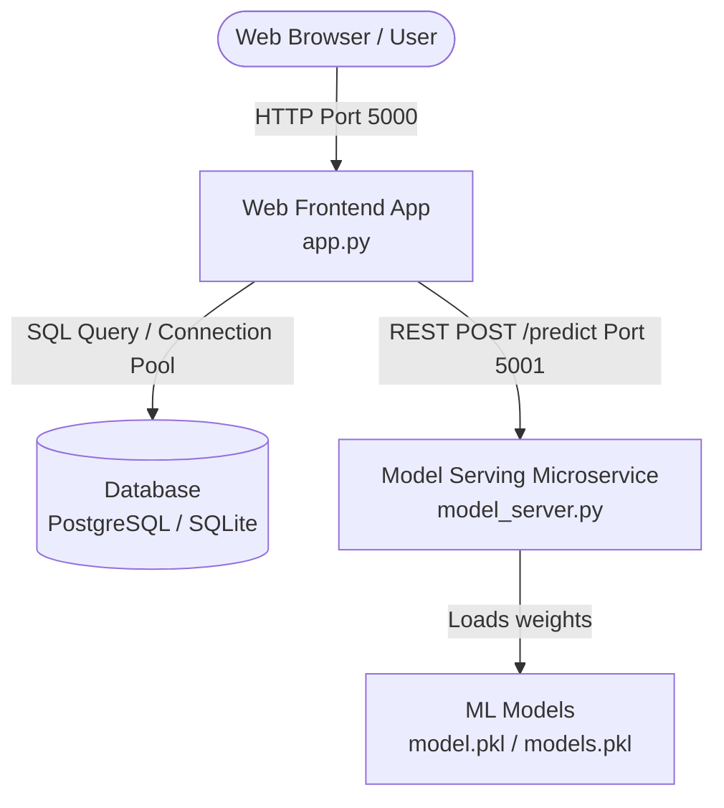

# Cloud Cost Prediction System ☁️💰

An interactive, high-fidelity, and decoupled machine learning application designed to estimate cloud infrastructure costs from historical resource utilization metrics. Built with **Flask**, **Scikit-Learn**, and **Bootstrap (Glassmorphism UI)**, the system helps developers and enterprises size their cloud instances, compare ML model metrics, get dynamic budget-aware recommendations, and keep track of predictions.

---

## 🏗️ System Architecture (Decoupled Microservices)

The application features a decoupled, production-grade microservices architecture designed to be stateless and scalable.



1. **Web Frontend Tier (`app.py`):** Serves the UI, handles user configuration, executes optimization recommendations, manages SQL operations via connection pooling, and acts as the gateway to the ML model.
2. **Model Serving Tier (`model_server.py`):** A lightweight inference microservice that loads trained ML model weights and exposes a `/predict` REST endpoint for real-time predictions.
3. **Database Tier (`predictions.db` / PostgreSQL):** Logs all predictions. Uses a thread-safe connection pool with **Render PostgreSQL** in production and falls back to local **SQLite** when running locally.

---

## 📊 Dataset & Feature Engineering

The models are trained on real-world cloud workload data. The pipeline maps raw input data into five canonical features:
- `cpu_usage` (vCPUs/Core Hours)
- `memory_gb` (RAM allocated)
- `storage_gb` (Storage capacity)
- `bandwidth_gb` (Network egress transfer)
- `vm_count` (Number of virtual machines in cluster)

The target variable is **`cost`** (monetary hourly expense).

- **`Cloud_Dataset.csv`**: Baseline dataset containing real cloud workload records.
- **`Final_Cloud_Dataset.csv`**: An augmented dataset with 5,000+ records generated via a noise-controlled scaling algorithm to improve regression generalization.

---

## 🤖 Models & Evaluation

The training script automatically trains, evaluates, and compares three core machine learning models:
1. **Linear Regression:** Baseline parametric regression mapping resource coefficients.
2. **Decision Tree Regression:** Non-linear rule-based regression.
3. **Random Forest Regression:** High-accuracy ensemble bagging regressor.

Models are evaluated using 5-fold cross-validation and test-split metrics (MSE, RMSE, $R^2$). The model with the lowest **RMSE** is automatically selected as the active model for inference.

---

## 🚀 Key Features

* **Glassmorphism UI:** Built with Outfit typography, custom sliders, responsive layouts, and interactive dashboards.
* **Budget-Aware Advisor:** Generates dynamic, cost-impact-based optimization suggestions (reductions or family swaps) if predictions exceed the defined monthly budget.
* **Side-by-Side Model Comparison:** View predictions across all three models concurrently.
* **Detailed Cost Breakdown:** A breakdown highlighting the percentage cost contribution of each hardware resource.
* **Persistent History Log:** Searchable and scrollable list of all previous predictions stored inside the relational database.

---

## 🛠️ Local Setup & Running

### 1. Install Dependencies
```bash
pip install -r requirements.txt
```

### 2. Train Models & Preprocess Dataset
```bash
python train_model.py
```
This generates:
- `model.pkl` (Best model weights)
- `models.pkl` (Dictionary containing all trained models)
- `model_metrics.json` (Calculated metrics, features importance, and metadata)
- `prepared_training_dataset.csv` (Preprocessed dataset used to dynamically bound frontend sliders)

**Optional: Dataset Augmentation**
To generate an augmented dataset with noise-controlled variation:
```bash
python augment_dataset.py --rows 5000
```

### 3. Run the Microservices Locally

**Single-Process Monolith Configuration (Fallback)**
When run directly, the web application loads models locally from the root directory:
```bash
python app.py
```
Access the application at: [http://127.0.0.1:5000](http://127.0.0.1:5000)

**Multi-Process Microservice Configuration**
Alternatively, the web server and the machine learning model serving server can be run as separate independent processes:
1. Start the Model Inference Server (Port 5001):
```bash
$env:PORT="5001"
python model_server.py
```
2. Start the web frontend application (Port 5000) pointing to the inference microservice:
```bash
$env:MODEL_SERVER_URL="http://127.0.0.1:5001"
python app.py
```

---

## 🐳 Docker Deployment (Recommended)

Run the entire multi-container environment (Frontend + Inference Server) with a single command:
```bash
docker compose up --build
```
Access the application dashboard at [http://127.0.0.1:5000](http://127.0.0.1:5000).

---

## ☁️ Production Deployment on Render

The repository includes a `render.yaml` blueprint for Infrastructure as Code (IaC) deployment on the Render platform:
1. Connect the GitHub repository to the Render dashboard.
2. Render automatically provisions the following resources:
   - **PostgreSQL database:** Statically allocated container for prediction records history.
   - **Model Inference Service:** Standard Python service running `model_server.py` to expose the predictions API.
   - **Frontend Web Service:** Standard Python service running `app.py`, serving the UI and communicating with the database and inference server.
3. Environment variables (`DATABASE_URL`, `MODEL_SERVER_URL`) are automatically injected to link the components together.

