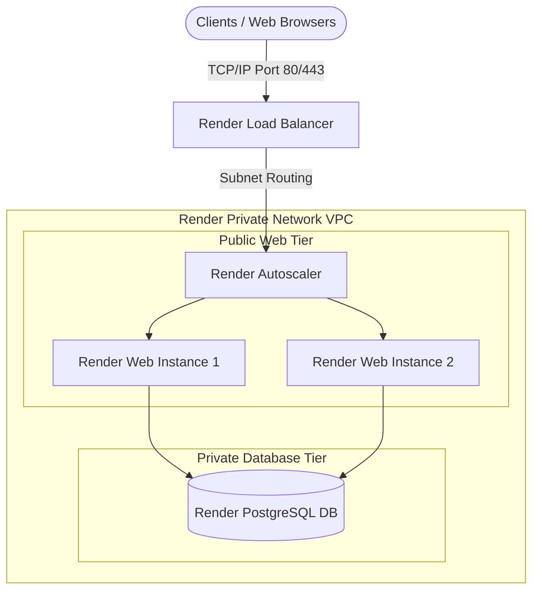

# Cloud Cost Predictor - Render Cloud Architecture & Class Slides Report

This document explains how our **Cloud Cost Prediction System** works specifically on the **Render Cloud Platform**, mapped directly to what you learned in your Cloud Computing classes (Weeks 1 to 5). 

---

## 🗺️ Part 1: Course Keywords Explained Simply

Here is how the main keywords from your slides are actually used in our project:

| Keyword from Slides | What it Means in Plain English | How We Implemented It on Render |
| :--- | :--- | :--- |
| **Measured Service / Utility Computing** | Paying for cloud resources like a utility bill (just like paying for water or electricity based on how much you consume). | Our application takes CPU, RAM, and Storage numbers and calculates (predicts) the exact utility cost that cloud providers would bill you. |
| **Dynamic Resizing / Elasticity** | Changing the size of your server (making CPU, RAM, or storage bigger or smaller) whenever your traffic changes. | Our slider controls let users change CPU/RAM dynamically. The application instantly predicts how this resizing changes the monthly price. |
| **Virtual Clusters** | Running multiple Virtual Machines (VMs) together as a team to handle heavy workloads. | We added a **VM Count** slider in the app. The app automatically calculates the total cost of running a cluster of several VMs. |
| **Over-provisioning** | Wasting money by buying a server that is way too big for your actual needs. | Our **Optimization Advisor** checks your inputs. If your server is too big, it warns you: *"You are over-provisioned (wasting money). Swap to a smaller size to save money!"* |
| **Under-provisioning** | Saving money but renting a server that is too small, causing the site to crash under heavy load. | If your inputs are dangerously low (e.g., too little RAM for heavy workloads), the advisor warns you that your server might crash. |
| **Decoupled Architecture** | Separating the web application (the brain) from the database (the memory) so they run on completely separate servers. | We moved our database from a local file (SQLite) to a separate cloud database (**Render PostgreSQL**). This keeps our web servers completely stateless. |

---

## 🏗️ Part 2: Render Architecture Design ("Hissab" vs. "Behisaab")

In cloud computing, nothing is truly infinite ("Behisaab"). Render's Free tier has strict limits ("Hissab") that we must plan for. Here is our setup.

### 1. Where the Story Begins (Our Render Baseline)
Our system is designed to support **1,000 active users** making up to 10 predictions per hour.
* **The Web Server**: 1 Render Free Web Instance with **512 MB RAM** and **Shared CPU** capacity.
* **The Storage (Ephemeral / Temporary)**: Render Free Web instances have **temporary local storage**. Whenever the server restarts or we push new code, the local files are wiped clean.
* **The Database**: A separate **Render PostgreSQL Free Instance** with **256 MB RAM** and a **1 GB storage limit**.
* **The Network**: Hard limit of **100 GB / month** of outgoing data transfer (Egress).

### 2. The Hard Physical Limits ("Hissab") & The SQLite Problem
Even in the cloud, a cheap VM has strict physical boundaries:
* **RAM Limit (512 MB)**: If our web server uses more than 512 MB of memory, Render will immediately terminate it (known as an **OOM crash / Command exited with status 137**).
* **The Disk Storage Problem (Why we moved to PostgreSQL)**: Because Render's web tier local storage is temporary, a local SQLite database file would be completely deleted every time the server restarts. To solve this, we migrated to a separate, persistent **Render PostgreSQL database** to keep prediction history safe.

---

## 🛜 Part 3: How the Network Works (The Protocol Stack)

We set up our network rules based on the standard **TCP/IP stack** (the communication layers):

1. **Render Private VPC**: This is our private virtual private cloud network. All traffic between the web app and the database is internal and secure.
2. **Public Web Tier**: Render's Load Balancer opens **Port 80/443 (HTTP/HTTPS)** so users on the internet can visit the website.
3. **Private Database Tier**: Our PostgreSQL database runs here. It is completely locked and invisible to the public internet. Only our web servers are allowed to talk to it.
4. **Reliable Communication (TCP)**: Client requests and predictions are sent over **TCP** to make sure no data gets lost along the way.

---

## 📈 Part 4: How We Scale Up in the Future

If our user base grows from **1,000 to 100,000+ users**, we scale up using three steps:

1. **Load Balancer**: Render's built-in Load Balancer handles the incoming traffic and routes it to the active web instances.
2. **Horizontal Scaling**: We scale our Render Web tier from 1 instance to multiple running instances (e.g. 2, 5, or 10 instances).
3. **Centralized Database**: Because we separated our database (**Render PostgreSQL**), all web servers talk to the same database. This keeps all prediction history perfectly synchronized for all users, no matter which server they are connected to!
