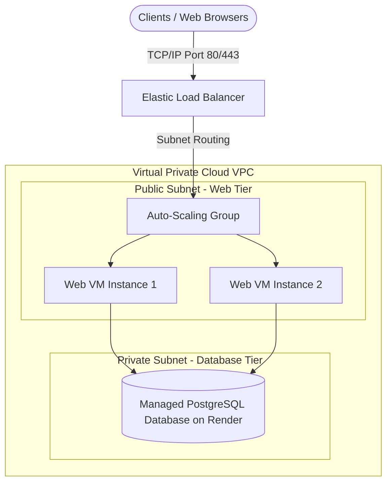

# Cloud Cost Predictor - Cloud Architecture & Class Slides Alignment Report

This document maps the **Cloud Cost Prediction System** directly to the topics, terminology, and core concepts covered in your **Cloud Computing Lecture Slides** (Weeks 1 to 5) taught by your instructor.

---

## 🗺️ Part 1: Slide Key Terms Mapped to Our Implementation

Below are the exact key terms from your course slides (Weeks 1 to 5) and how they are implemented in our project:

| Slide Key Term | Slide Source | Project Implementation Details |
| :--- | :--- | :--- |
| **Measured Service / Utility Computing** | Week 1 & Week 5 Lecture 10 | John McCarthy's 1961 vision of "computation provisioned as a utility". Our system is a **predictive metering engine** for a measured service. It takes hardware metrics (vCPU, RAM, storage, network bandwidth) and models how public cloud providers calculate utility costs. |
| **Scalable Computing / Dynamic Resizing** | Week 3 Lecture 5 | Defined as the "dynamic resizing of the available computing resources (processing, memory, bandwidth, storage etc.) with demand". Our interface allows users to slide resources up/down dynamically, predicting how these changes scale the hourly cost. |
| **Virtual Clusters** | Week 4 Lecture 8 | "Several VMs hosted on a physical cluster". Handled in the frontend and backend through the `vm_count` and `vms` parameters. The model projects the cost for a cluster of VMs working in parallel. |
| **Over-provisioning & Under-provisioning** | Week 5 Lecture 10 | Explains the financial and operational risks of:  • *Over-provisioning*: Buying/renting too much capacity, resulting in wasted budget. • *Under-provisioning*: Renting inadequate capacity, resulting in server saturation and service crashes. Our **Cloud Cost Intelligence Engine** alerts users if their configuration is too large (wasting money) or too small (crashing under load). |
| **TCP/IP Protocol Stack** | Week 2/3 Lecture 4 | We configured the networking layers, ports, and firewall rules to allow Web traffic (HTTP/TCP port 5000 / 80) to route securely into the VM container. |
| **Decoupled Architecture & State Separation** | Week 5 Lecture 11 | Separating compute nodes from storage. We have **fully implemented** this by separating our Flask Web servers from a central, managed PostgreSQL database on Render. This allows us to scale web servers horizontally while keeping data synced. |

---

## 🏗️ Part 2: Cloud Architecture Design ("Hissab" vs. "Behisaab")

Even in the cloud, resources are not truly infinite. Every system starts with boundaries ("Hissab" - accounting). Below is the design of our starting workload baseline and how it scales for future growth.

### 1. The Starting Baseline (Where the Story Begins)
* **Initial Client Workload**: Structured to support **1,000 active users** making up to 10 predictions per hour.
* **Compute Instance**: 1 VM instance (AWS `t3.micro` or GCP `e2-micro`) with **2 vCPUs** and **1 GB RAM**.
* **Storage Allocation**: **20 GB SSD** (holds the operating system and Docker container, while history data is pushed to the database).
* **Network Egress Limits**: Hard capped at **10 GB / month** of outgoing data.

### 2. Physical & Technical Limits ("Hissab")
Even on the cloud, a `t3.micro` instance has strict physical thresholds:
* **Memory Limit**: 1 GB RAM. If memory usage exceeds this, the OS Out-of-Memory (OOM) killer will immediately terminate the Flask server.
* **CPU Credits**: Low-tier VMs use a burstable CPU credit system. If the system is under constant high load, credits deplete, and the CPU speed is throttled to 10% performance.
* **Bandwidth Limit**: Network capacity is throttled to a maximum of 5 Gbps burst speed.

---

## 🛜 Part 3: Network Architecture & Protocols (Lecture 4 Protocol Stack)

Our network configuration is built on the standard **TCP/IP Protocol Stack** layers discussed in Week 2/3 Lecture 4:

1. **Physical & Link Layer**: Under the hood, public fiber networks connect Render or AWS data centers to the internet.
2. **Network Layer (IP/Routing)**: 
   * We deploy our app inside a **Virtual Private Cloud (VPC)**.
   * **Subnet Partitioning**: The Web App runs in a **Public Subnet** (accessible to the internet), while our database runs in a **Private Subnet** (hidden from the public internet).
   * **Firewalls & Security Groups**: The firewall blocks all inbound traffic except **Port 80/443 (HTTP/HTTPS)** and **Port 22 (SSH)**.
3. **Transport Layer (TCP)**: 
   * Uses **TCP** (Transmission Control Protocol) to ensure reliable, connection-oriented data transfer. Client requests and server predictions must arrive error-free.
4. **Application Layer**: 
   * Runs the **HTTP/HTTPS** protocols to serve HTML templates, JSON API predictions, and database query results.

---

## 📈 Part 4: Future Growth & Decoupled State Scaling

By default, hosting databases locally on the web server (like local SQLite or CSV files) creates stateful web servers. If you scale to 5 or 10 servers, each server will have its own separate history, and if a server crashes, its data is lost.

To solve this, we implemented **Database Separation of Concerns**:

1. **State Isolation**:
   * We separated the web application from the database. The Flask application is now **stateless**.
   * All user prediction logs and history are saved to a separate, managed **PostgreSQL** database resource.
2. **Horizontal Auto-Scaling**:
   * Since the Flask servers are stateless, we can safely scale horizontally (e.g., from 1 web instance to 5, 10, or 100).
   * An **Elastic Load Balancer (ELB)** distributes user traffic round-robin among the stateless instances.
   * Every instance reads and writes to the same centralized PostgreSQL database, keeping data perfectly synced for all users.
3. **Fault Tolerance**:
   * If Web Instance #1 runs out of RAM (OOM) and crashes, the Load Balancer instantly reroutes traffic to Web Instance #2.
   * Because the database is hosted independently, no data is lost during web server crashes.
